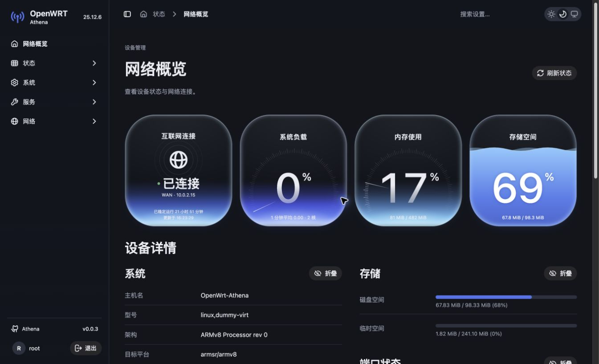
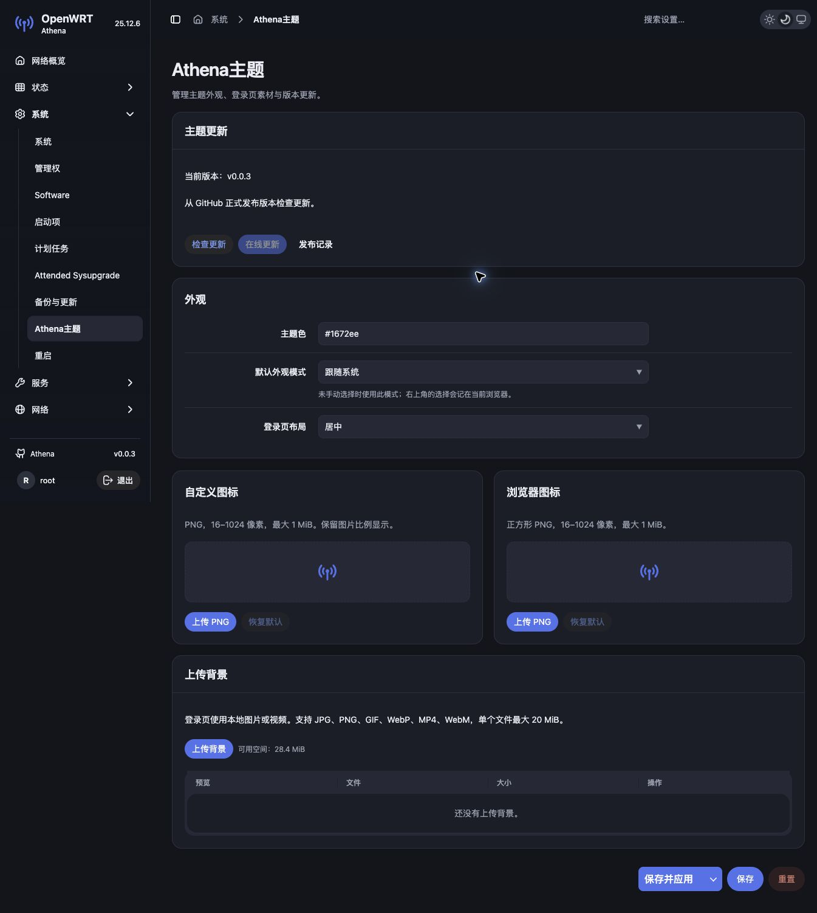
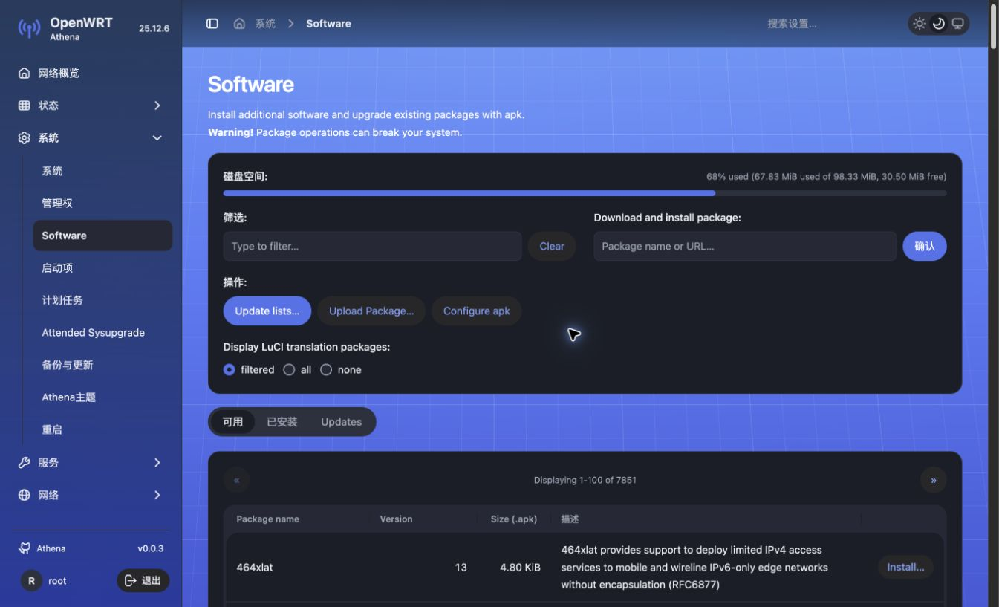

[简体中文](README.md) · [English](README.en.md) · [日本語](README.ja.md) · [한국어](README.ko.md) · [Français](README.fr.md) · [Deutsch](README.de.md) · [العربية](README.ar.md)

# Athena v0.0.5

Athena ist ein natives OpenWrt-LuCI-Theme mit HeroUI als Gestaltungsvorbild. Es verwendet ucode-Vorlagen, rpcd sowie die JavaScript-, Formular- und UCI-Schnittstellen von LuCI. Es enthält weder eine React-Laufzeit noch Argon-Stile. Auf dem Router ist kein Node.js erforderlich.

## Bildschirmansichten

Aufnahmen im dunklen Modus einer lokalen Entwicklungsumgebung mit OpenWrt 25.12.6. Sprache, Versionsangaben und Paketlisten hängen von der Installation ab.

### Übersicht

Internetverbindung, Systemlast, Arbeitsspeicher und animierter Flüssigkeitsspeicher auf einen Blick, mit einklappbaren Gerätedetails.



### Athena-Theme-Einstellungen

Standarddarstellung, Anmeldeansicht, Symbole und Hintergründe verwalten sowie offizielle Releases auf Updates prüfen.



### Paketverwaltung

Einheitliche Filter, Installationsaktionen, Tabs und Pakettabellen für LuCI; der native Ablauf der Paketverwaltung bleibt erhalten.



## Funktionen

- Responsive Seitenleiste, gemeinsame Tabellen und Bedienelemente, Scroll-Schatten und Dialoge.
- Heller Modus, dunkler Modus und Systemeinstellung; die Systemeinstellung ist der Anfangswert.
- Zentrierte oder geteilte Anmeldung, schlanker SVG-Hintergrund, transparente Glaspaneele und Passwortanzeige.
- Eigene PNG-Logos und Favicons sowie hochgeladene Bild- oder Videohintergründe.
- Prüfung stabiler Versionen, Archivprüfung und Sicherungen zur Wiederherstellung.

## Installation

Laden Sie das passende Paket unter [Releases](https://github.com/NXN-MAX/OpenWRT-Athena/releases) herunter und prüfen Sie es mit `SHA256SUMS`. Kopieren Sie es nach `/tmp` und führen Sie den passenden Befehl aus.

| Umgebung | Format | Befehl |
| --- | --- | --- |
| OpenWrt 24.10 / opkg | `.ipk` | `opkg install /tmp/luci-theme-athena_*.ipk` |
| OpenWrt 25.12 / apk | `.apk` | `apk add --allow-untrusted /tmp/luci-theme-athena-*.apk` |

Dies sind eigenständige SDK-Builds ohne Signatur des offiziellen OpenWrt-Paketarchivs. Mischen Sie die Formate nicht. IPK verwendet die Architektur `all`, APK `noarch`. Die Abhängigkeiten `luci-base`, `rpcd-mod-ucode`, `ucode-mod-fs`, `ucode-mod-uci`, `curl` und `ca-bundle` werden aus den zur Firmware passenden Paketquellen installiert.

Vorhandene Einstellungen in `/etc/config/athena` und hochgeladene Medien bleiben erhalten. Wechseln Sie vor der Deinstallation zu einem anderen installierten Theme. Verwenden Sie danach `opkg remove luci-theme-athena` oder `apk del luci-theme-athena`.

## Einstellungen und Updates

**System → Athena-Theme**: `/cgi-bin/luci/admin/system/Athena-config`. Die Konfiguration liegt in `/etc/config/athena`. Hier wählen Sie das anfängliche Erscheinungsbild, das Anmeldelayout und die Medien. Eine manuelle Moduswahl wird im Browser gespeichert. Der Hostname bleibt in den nativen LuCI-Einstellungen unter **System → System → Allgemeine Einstellungen**.

Die einzige Updatequelle ist der offizielle Release-Anhang [`athena-release.json`](https://github.com/NXN-MAX/OpenWRT-Athena/releases/latest/download/athena-release.json). Es gibt keinen Rückgriff auf die GitHub-API, einen Repository-Branch oder einen Spiegelserver. Ein fehlendes oder ungültiges Manifest führt zu einer Fehlermeldung. Geprüft werden stabile Version, offizielle URL, Dateiname, Größe und SHA256; das heruntergeladene Archiv wird erneut geprüft. Nur neuere stabile Versionen können installiert werden.

Der integrierte Updater verwendet `.tar.gz`, erhält Einstellungen und Medien und legt Sicherungen unter `/etc/athena/backups/` an. Der Versionsstand in der Paketverwaltung wird dabei nicht geändert. Verwenden Sie für Updates über die Paketverwaltung das passende IPK/APK. Ein entpacktes Archiv lässt sich auch mit `sh scripts/install.sh` installieren.

## Build und Prüfungen

```sh
npm ci
npm run build
npm test
npm run pack
```

Der Build verwendet `@heroui/styles` und erzeugt statisches CSS sowie einen Cache-Hash. `dist/` enthält das Archiv und die Prüfsumme. Offizielle SDKs erzeugen IPK/APK. Erst nach zwei erfolgreichen SDK-Builds wird veröffentlicht; das Manifest wird aus dem tatsächlichen Archiv erzeugt. Vor einer neuen Version müssen `package.json`, Lockdatei und `Makefile` übereinstimmen.

Gerätetests verwenden einen vom Entwickler bereitgestellten SSH-Wrapper und isolierte temporäre Pfade:

```sh
ATHENA_SSH=/path/to/device-ssh scripts/test-device.sh
ATHENA_SSH=/path/to/device-ssh python3 scripts/test-updater-device.py
```

## Aufbau und Kompatibilität

Vorlagen liegen in `ucode/template/themes/athena/`; gemeinsamer UI-Adapter, Menü und Einstellungen in `htdocs/luci-static/resources/`. RPC: `root/usr/share/rpcd/ucode/luci.athena`. Updater: `root/usr/libexec/athena-update`.

Getestete Laufzeitumgebung: OpenWrt 25.12.6 / armsr/armv8. Das IPK wird mit dem SDK 24.10 gebaut; ein erfolgreicher Build ist kein vollständiger Gerätetest. OpenWrt 23.05 wurde nicht auf einem Gerät geprüft. Moderne CSS- und JavaScript-Unterstützung ist erforderlich. Lua-Abhängigkeiten fremder Anwendungen sind vom Theme unabhängig. Firmware-Updates, Gerätefunktionen sowie OpenClash-Kern und Abonnements sind nicht Teil der Theme-Tests.

## Lizenz und Quellen

Apache-2.0; siehe [LICENSE](LICENSE), [NOTICE](NOTICE) und [Drittlizenzen](licenses/). Referenzen: [LuCI-Theme-Struktur](https://github.com/openwrt/luci/wiki/HowTo:-Create-Themes), [HeroUI](https://github.com/heroui-inc/heroui), [Gravity UI Icons](https://github.com/gravity-ui/icons) sowie Thermal Dial und Theme Switch von Pin UI. Die React-Implementierungen dieser Beispiele werden nicht auf dem Router ausgeliefert.
