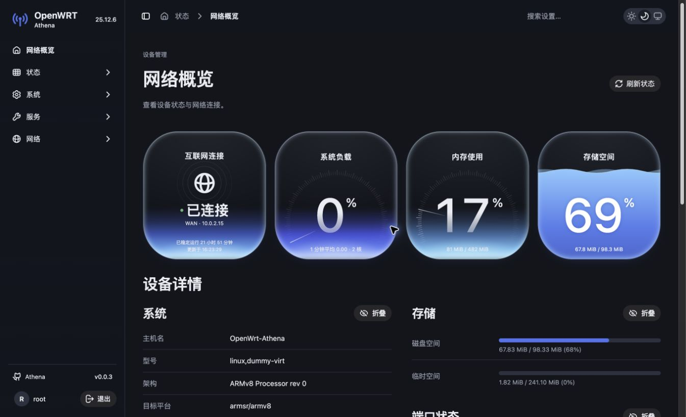
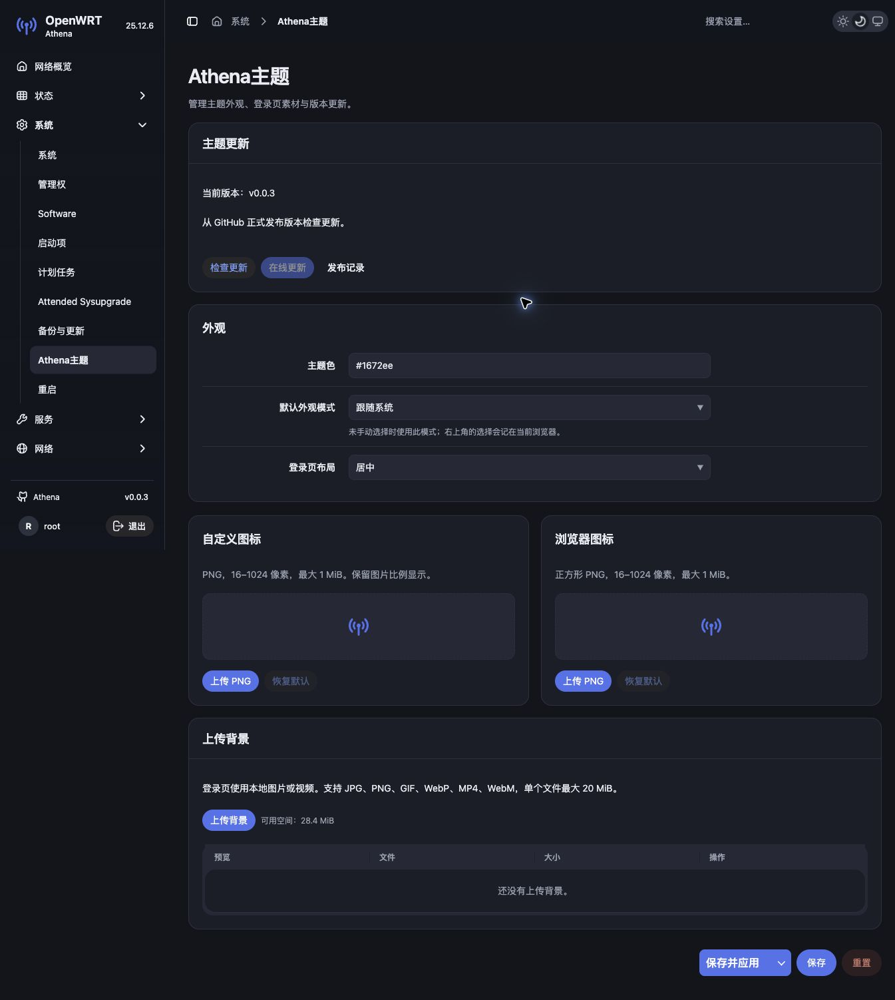
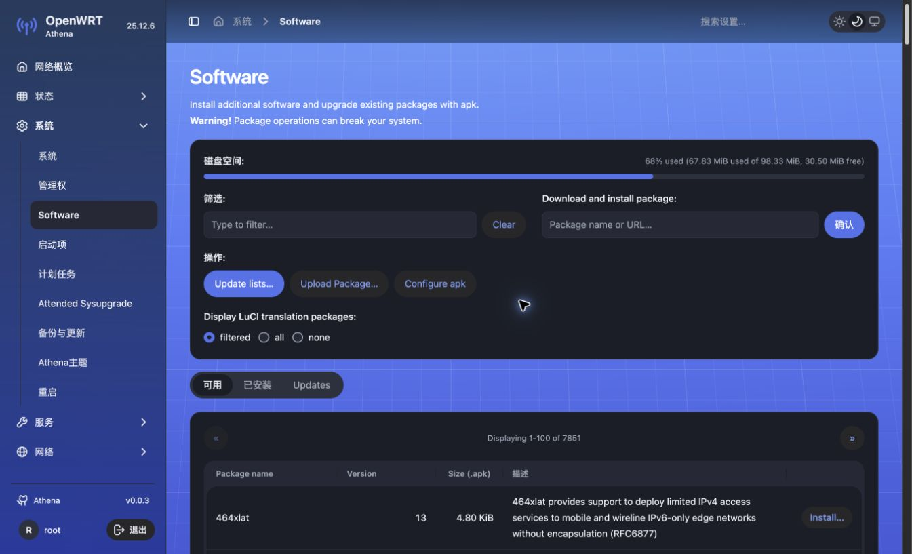

[简体中文](README.md) · [English](README.en.md) · [日本語](README.ja.md) · [한국어](README.ko.md) · [Français](README.fr.md) · [Deutsch](README.de.md) · [العربية](README.ar.md)

# Athena v0.0.6

Athena is a native OpenWrt LuCI theme inspired by HeroUI. It uses ucode templates, rpcd and LuCI's own JavaScript, forms and UCI interfaces. It ships no React runtime or Argon styles and requires no Node.js on the router.

## Screenshots

Captured in dark mode on the local OpenWrt 25.12.6 development environment. Language, version labels and package lists depend on the installed environment.

### Overview

Connection status, system load, memory and animated liquid storage cards, with collapsible device details.



### Athena theme settings

Manage default appearance, login layout, icons and backgrounds, and check official Releases for updates.



### Package manager

A consistent layout for native LuCI filters, installation controls, tabs and package tables, preserving the original package-management flow.



## Features

- Responsive sidebar, shared tables and controls, scroll shadows and dialogs.
- Light, dark and system appearance modes; system is the initial default.
- Centered or split login layouts, a lightweight SVG background, glass panels and password visibility controls.
- Custom PNG logo/favicon and uploaded image or video backgrounds.
- Stable release checks, archive verification and rollback backups.

## Installation

Download the appropriate package from [Releases](https://github.com/NXN-MAX/OpenWRT-Athena/releases). Verify its checksum against `SHA256SUMS` before installing.

| Firmware / package manager | Package | Command after copying it to `/tmp` |
| --- | --- | --- |
| OpenWrt 24.10 / opkg | `.ipk` | `opkg install /tmp/luci-theme-athena_*.ipk` |
| OpenWrt 25.12 / apk | `.apk` | `apk add --allow-untrusted /tmp/luci-theme-athena-*.apk` |

These are independent SDK builds, not packages signed by the official OpenWrt repository. Do not mix the formats. IPK uses `all`; APK uses `noarch`. Dependencies are installed from your firmware's own feeds: `luci-base`, `rpcd-mod-ucode`, `ucode-mod-fs`, `ucode-mod-uci`, `curl` and `ca-bundle`.

Existing `/etc/config/athena` and uploaded assets are preserved. Before uninstalling, select another installed theme, then use `opkg remove luci-theme-athena` or `apk del luci-theme-athena`.

## Settings and updates

Open **System → Athena theme** at `/cgi-bin/luci/admin/system/Athena-config`. The configuration file is `/etc/config/athena`. Select the default appearance, login layout and branding here. A manual appearance choice is saved in the browser. The hostname stays in LuCI's native **System → System → General Settings**.

The sole update source is the official Release attachment [`athena-release.json`](https://github.com/NXN-MAX/OpenWRT-Athena/releases/latest/download/athena-release.json). There is no GitHub API, branch or mirror fallback. An unavailable or invalid manifest produces an error. The updater validates the stable version, repository URL, archive name, size and SHA256, then verifies the downloaded archive. Only newer stable versions are installed.

The built-in updater uses `.tar.gz`, preserves settings and assets, and saves backups under `/etc/athena/backups/`. It does not update the package manager's installed-version record. Package-manager upgrades should use the matching IPK/APK. Archive installation can also be performed with `sh scripts/install.sh` after extraction.

## Build and checks

```sh
npm ci
npm run build
npm test
npm run pack
```

The build uses `@heroui/styles` and generates static CSS and a resource cache hash. `dist/` contains the prebuilt archive and its checksum. Official SDK builds produce IPK/APK packages. The release workflow generates the manifest from the actual archive and publishes only after both SDK builds succeed. Increase the version consistently in `package.json`, its lockfile and `Makefile` before a new release.

Device checks use a developer-provided SSH wrapper and isolated temporary paths:

```sh
ATHENA_SSH=/path/to/device-ssh scripts/test-device.sh
ATHENA_SSH=/path/to/device-ssh python3 scripts/test-updater-device.py
```

## Layout and compatibility

`ucode/template/themes/athena/` contains native templates; `htdocs/luci-static/resources/` contains the shared UI adapter, menu and settings view. The RPC lives in `root/usr/share/rpcd/ucode/luci.athena`; the installer/updater in `root/usr/libexec/athena-update`.

The tested runtime is OpenWrt 25.12.6 on armsr/armv8. IPK is built with the 24.10 SDK; a build is not a complete device compatibility test. OpenWrt 23.05 has not been device-tested. Modern CSS and JavaScript support is required. A third-party application's own Lua dependencies are independent of the theme. Firmware upgrades, device functions and OpenClash core/subscriptions are outside theme tests.

## License and references

Apache-2.0; see [LICENSE](LICENSE), [NOTICE](NOTICE) and [third-party licenses](licenses/). References: [LuCI theme structure](https://github.com/openwrt/luci/wiki/HowTo:-Create-Themes), [HeroUI styles](https://github.com/heroui-inc/heroui), [Gravity UI Icons](https://github.com/gravity-ui/icons), and the Pin UI thermal dial and theme switch examples. React versions of these examples are not shipped to the router.
