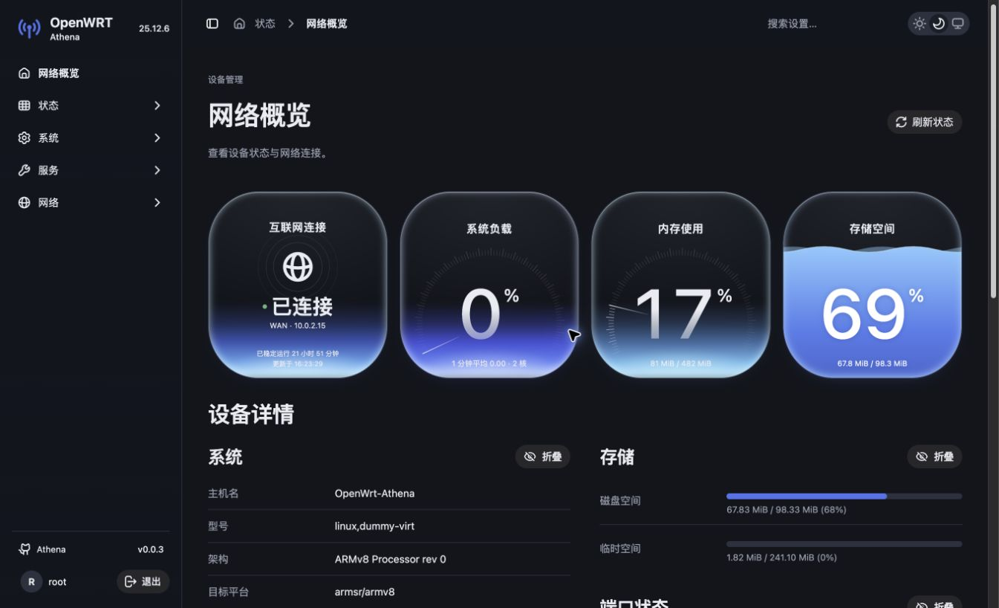
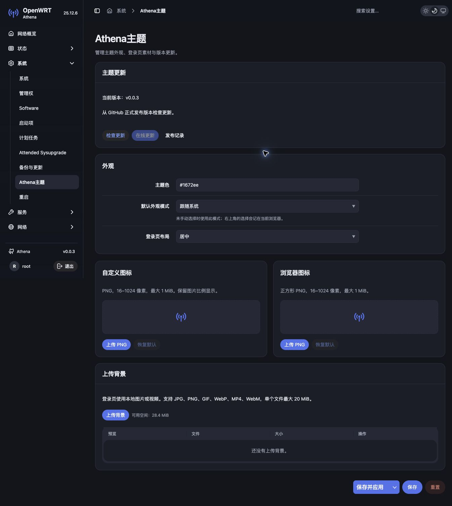
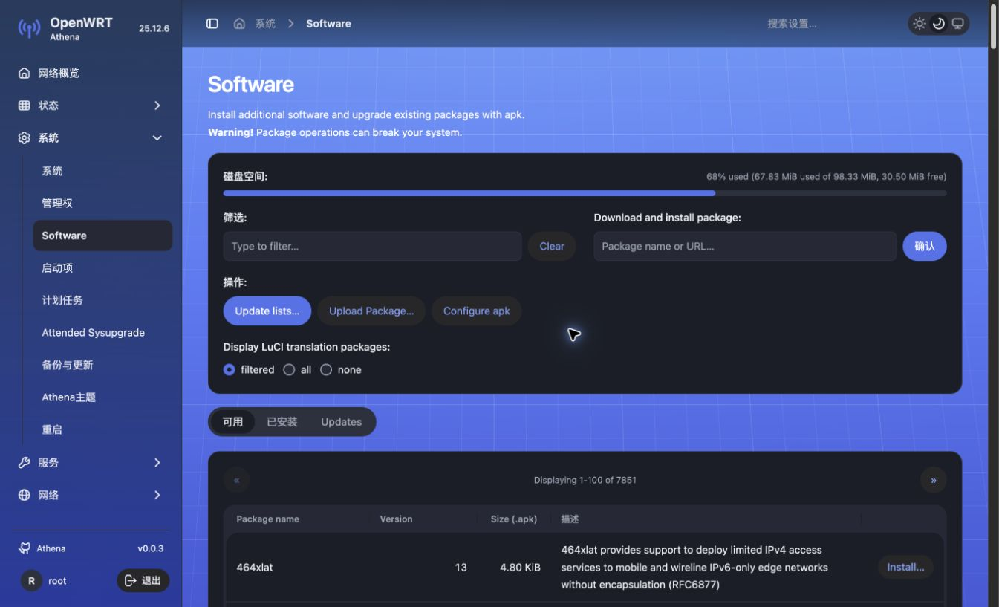

[简体中文](README.md) · [English](README.en.md) · [日本語](README.ja.md) · [한국어](README.ko.md) · [Français](README.fr.md) · [Deutsch](README.de.md) · [العربية](README.ar.md)

# Athena v0.0.6

Athena est un thème natif pour OpenWrt LuCI inspiré de HeroUI. Il utilise des modèles ucode, rpcd et les interfaces JavaScript, formulaires et UCI de LuCI. Il ne contient ni environnement React ni styles Argon. Node.js n’est pas nécessaire sur le routeur.

## Aperçu en images

Captures en mode sombre dans un environnement de développement local sous OpenWrt 25.12.6. La langue, les versions et la liste des paquets dépendent de votre installation.

### Vue d’ensemble

Connexion Internet, charge système, mémoire et stockage animé comme un liquide, avec les détails de l’appareil repliables.



### Réglages du thème Athena

Gérez l’apparence par défaut, la connexion, les icônes et les fonds, puis recherchez les mises à jour dans les Releases officielles.



### Gestionnaire de paquets

Une présentation cohérente des filtres, actions d’installation, onglets et tableaux de LuCI, en conservant son fonctionnement natif.



## Fonctionnalités

- Barre latérale adaptative, tableaux et contrôles communs, ombres de défilement et boîtes de dialogue.
- Modes clair, sombre et système ; le mode système est sélectionné par défaut.
- Connexion centrée ou en deux colonnes, fond SVG léger, panneaux translucides et affichage du mot de passe.
- Logo et favicon PNG personnalisés, fonds image ou vidéo téléversés.
- Recherche de versions stables, vérification des archives et sauvegardes de restauration.

## Dépôt de paquets signés

Le [dépôt signé Athena](doc/signed-feed.md) prend en charge opkg/IPK sur OpenWrt 24.10 et APKv3 sur 25.12, sans désactiver la vérification des signatures. Après activation, utilisez le gestionnaire de paquets natif pour les mises à jour. Ce dépôt tiers est indépendant ; la préparation de son inclusion officielle est en cours. Les instructions suivantes concernent les fichiers Release téléchargés séparément.

## Installation

Téléchargez le paquet adapté depuis les [Releases](https://github.com/NXN-MAX/OpenWRT-Athena/releases) et vérifiez-le avec `SHA256SUMS`. Copiez-le dans `/tmp`, puis exécutez la commande correspondante.

| Environnement | Format | Commande |
| --- | --- | --- |
| OpenWrt 24.10 / opkg | `.ipk` | `opkg install /tmp/luci-theme-athena_*.ipk` |
| OpenWrt 25.12 / apk | `.apk` | `apk add --allow-untrusted /tmp/luci-theme-athena-*.apk` |

Ces paquets sont construits indépendamment avec le SDK et ne portent pas la signature du dépôt officiel OpenWrt. Ne mélangez pas les formats. L’architecture est `all` pour IPK et `noarch` pour APK. Les dépendances `luci-base`, `rpcd-mod-ucode`, `ucode-mod-fs`, `ucode-mod-uci`, `curl` et `ca-bundle` proviennent des dépôts adaptés à votre micrologiciel.

Le fichier `/etc/config/athena` et les médias existants sont conservés. Avant de désinstaller, sélectionnez un autre thème installé, puis utilisez `opkg remove luci-theme-athena` ou `apk del luci-theme-athena`.

## Réglages et mises à jour

**Système → Thème Athena** : `/cgi-bin/luci/admin/system/Athena-config`. La configuration se trouve dans `/etc/config/athena`. Réglez l’apparence initiale, la disposition de connexion et les médias. Le choix manuel de l’apparence est mémorisé par le navigateur. Le nom d’hôte reste dans les réglages natifs **Système → Système → Général** de LuCI.

L’unique source des mises à jour est la pièce jointe de la Release officielle [`athena-release.json`](https://github.com/NXN-MAX/OpenWRT-Athena/releases/latest/download/athena-release.json). Aucun repli vers l’API GitHub, une branche ou un miroir. Si le manifeste est indisponible ou invalide, une erreur s’affiche. Le thème vérifie la version stable, l’URL officielle, le nom, la taille et le SHA256, puis contrôle l’archive téléchargée. Seules les versions stables plus récentes sont installables.

La mise à jour intégrée utilise `.tar.gz`, conserve les réglages et médias et crée une sauvegarde dans `/etc/athena/backups/`. Elle ne modifie pas la version enregistrée par le gestionnaire de paquets. Utilisez l’IPK/APK correspondant pour une mise à niveau par celui-ci. Une archive extraite peut aussi être installée avec `sh scripts/install.sh`.

## Construction et vérification

```sh
npm ci
npm run build
npm test
npm run pack
```

La construction utilise `@heroui/styles` et génère le CSS statique et un identifiant de cache. `dist/` contient l’archive et sa somme de contrôle. Les SDK officiels produisent les paquets IPK/APK. La publication ne se fait qu’après la réussite des deux constructions ; le manifeste est généré à partir de l’archive réelle. Pour une nouvelle version, alignez `package.json`, son fichier de verrouillage et `Makefile`.

Les tests sur appareil utilisent un lanceur SSH fourni par le développeur et des chemins temporaires isolés :

```sh
ATHENA_SSH=/path/to/device-ssh scripts/test-device.sh
ATHENA_SSH=/path/to/device-ssh python3 scripts/test-updater-device.py
```

## Structure et compatibilité

Les modèles sont dans `ucode/template/themes/athena/`. L’adaptateur UI, le menu et les réglages sont dans `htdocs/luci-static/resources/`. Le RPC se trouve dans `root/usr/share/rpcd/ucode/luci.athena` et le programme de mise à jour dans `root/usr/libexec/athena-update`.

L’environnement testé est OpenWrt 25.12.6 / armsr/armv8. L’IPK est construit avec le SDK 24.10 ; une compilation réussie ne prouve pas la compatibilité avec tous les appareils. OpenWrt 23.05 n’a pas été testé sur appareil. Un navigateur compatible avec le CSS et JavaScript modernes est nécessaire. Les dépendances Lua des applications tierces sont indépendantes du thème. Les mises à niveau du micrologiciel, les fonctions matérielles et le cœur ou les abonnements OpenClash ne font pas partie de ces tests.

## Licence et références

Apache-2.0 : [LICENSE](LICENSE), [NOTICE](NOTICE) et [licences tierces](licenses/). Références : [structure des thèmes LuCI](https://github.com/openwrt/luci/wiki/HowTo:-Create-Themes), [HeroUI](https://github.com/heroui-inc/heroui), [Gravity UI Icons](https://github.com/gravity-ui/icons), Thermal Dial et Theme Switch de Pin UI. Aucun code React issu de ces exemples n’est envoyé au routeur.
