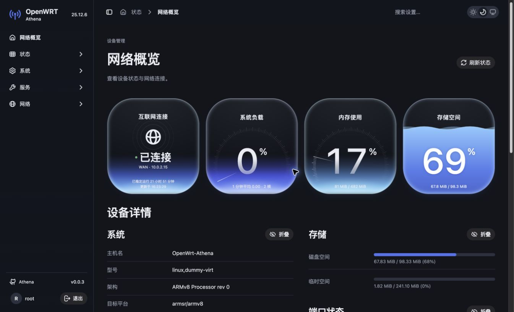
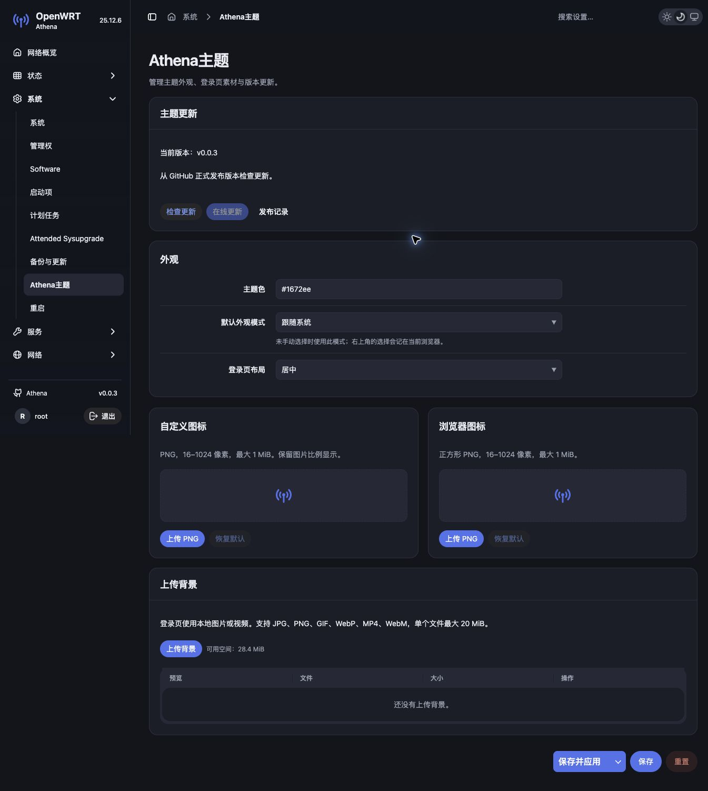
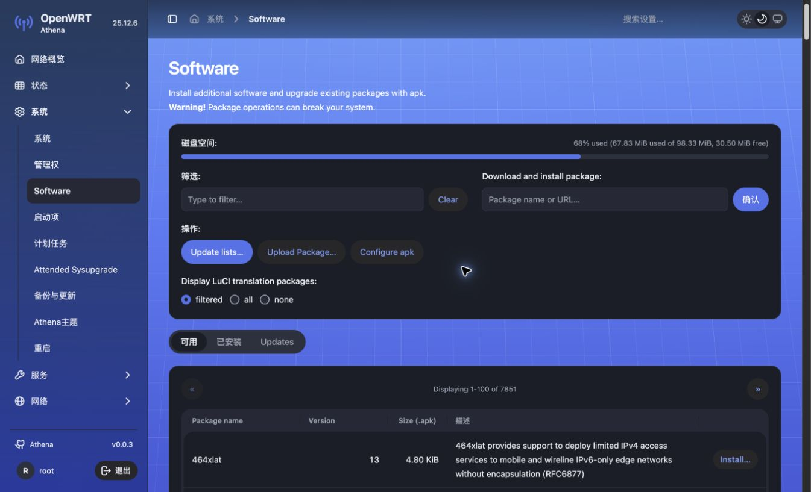

[简体中文](README.md) · [English](README.en.md) · [日本語](README.ja.md) · [한국어](README.ko.md) · [Français](README.fr.md) · [Deutsch](README.de.md) · [العربية](README.ar.md)

# Athena v0.0.4

Athena は HeroUI を参考にした OpenWrt LuCI 用のネイティブテーマです。ucode テンプレート、rpcd、LuCI 標準の JavaScript・フォーム・UCI インターフェースを使用します。React ランタイムや Argon のスタイルは含まず、ルーター上に Node.js は不要です。

## 画面プレビュー

ローカルの OpenWrt 25.12.6 開発環境で撮影したダークモードの画面です。表示言語、バージョン、パッケージ一覧は環境により異なります。

### ネットワーク概要

接続状態、システム負荷、メモリ、液体アニメーション付きストレージカードを集約。機器の詳細は折りたためます。



### Athena テーマ設定

既定の外観、ログインレイアウト、アイコン、背景を管理し、正式な Release から更新を確認できます。



### ソフトウェア管理

LuCI 標準のフィルター、インストール操作、タブ、パッケージ表を統一したレイアウトで表示し、標準の管理フローを維持します。



## 主な機能

- レスポンシブなサイドバー、共通テーブルと入力部品、スクロールシャドウ、ダイアログ。
- ライト・ダーク・システム設定に従う外観。初期設定はシステム連動です。
- 中央配置または分割レイアウトのログイン画面、軽量 SVG 背景、すりガラスパネル、パスワード表示切り替え。
- PNG ロゴ・ファビコン、画像・動画背景のアップロード。
- 安定版の確認、アーカイブ検証、ロールバック用バックアップ。

## インストール

[Releases](https://github.com/NXN-MAX/OpenWRT-Athena/releases) から環境に合うパッケージを取得し、`SHA256SUMS` で検証してください。`/tmp` に転送後、対応するコマンドを実行します。

| 環境 | 形式 | コマンド |
| --- | --- | --- |
| OpenWrt 24.10 / opkg | `.ipk` | `opkg install /tmp/luci-theme-athena_*.ipk` |
| OpenWrt 25.12 / apk | `.apk` | `apk add --allow-untrusted /tmp/luci-theme-athena-*.apk` |

独立した SDK ビルドであり、OpenWrt 公式リポジトリの署名は使用しません。形式を混用しないでください。アーキテクチャは IPK が `all`、APK が `noarch` です。依存パッケージ `luci-base`、`rpcd-mod-ucode`、`ucode-mod-fs`、`ucode-mod-uci`、`curl`、`ca-bundle` は、ファームウェアの対応フィードから取得します。

既存の `/etc/config/athena` とアップロード素材は保持されます。削除前に別のインストール済みテーマへ切り替え、`opkg remove luci-theme-athena` または `apk del luci-theme-athena` を実行してください。

## 設定と更新

**システム → Athena テーマ**：`/cgi-bin/luci/admin/system/Athena-config`。設定ファイルは `/etc/config/athena` です。初期外観、ログイン配置、素材を設定できます。手動で選んだ外観はブラウザーに保存されます。ホスト名は LuCI 標準の **システム → システム → 一般設定** で管理します。

更新元は正式 Release 添付の [`athena-release.json`](https://github.com/NXN-MAX/OpenWRT-Athena/releases/latest/download/athena-release.json) のみです。GitHub API、ブランチ、ミラーには切り替えません。マニフェストを取得できない場合や無効な場合はエラーを表示します。安定版番号、公式 URL、ファイル名、サイズ、SHA256 を検証し、取得後にも照合します。現在より新しい安定版だけを許可します。

内蔵更新機能は `.tar.gz` を使用し、設定と素材を保持して `/etc/athena/backups/` にバックアップします。パッケージ管理側のバージョン記録は更新しません。パッケージ管理で更新する場合は対応する IPK/APK を使用してください。展開済みアーカイブから `sh scripts/install.sh` で手動導入することもできます。

## ビルドと検証

```sh
npm ci
npm run build
npm test
npm run pack
```

`@heroui/styles` を使用して CSS とキャッシュ用ハッシュを生成し、`dist/` にアーカイブとチェックサムを出力します。IPK/APK は公式 SDK で作成します。両方の SDK ビルドに成功した場合にのみ、実アーカイブから更新マニフェストを生成して公開します。新しいリリースでは `package.json`、ロックファイル、`Makefile` のバージョンを揃えてください。

デバイス検証は開発者の SSH ラッパーと隔離された一時ディレクトリを使用します。

```sh
ATHENA_SSH=/path/to/device-ssh scripts/test-device.sh
ATHENA_SSH=/path/to/device-ssh python3 scripts/test-updater-device.py
```

## 構成と互換性

`ucode/template/themes/athena/` はテンプレート、`htdocs/luci-static/resources/` は共通 UI・メニュー・設定画面です。RPC は `root/usr/share/rpcd/ucode/luci.athena`、更新処理は `root/usr/libexec/athena-update` にあります。

実行検証環境は OpenWrt 25.12.6 / armsr/armv8 です。IPK は 24.10 SDK で構築しますが、ビルド成功は全デバイスでの動作保証ではありません。23.05 の実機検証は未実施です。モダンな CSS/JavaScript が必要です。第三者アプリの Lua 依存はテーマとは別です。ファームウェア更新、デバイス機能、OpenClash のコアや購読はテーマ検証の対象外です。

## ライセンスと参考資料

Apache-2.0。[LICENSE](LICENSE)、[NOTICE](NOTICE)、[第三者ライセンス](licenses/) を参照してください。参考：[LuCI テーマ構造](https://github.com/openwrt/luci/wiki/HowTo:-Create-Themes)、[HeroUI](https://github.com/heroui-inc/heroui)、[Gravity UI Icons](https://github.com/gravity-ui/icons)、Pin UI の Thermal Dial / Theme Switch。React 版の実装はルーターに配布しません。
