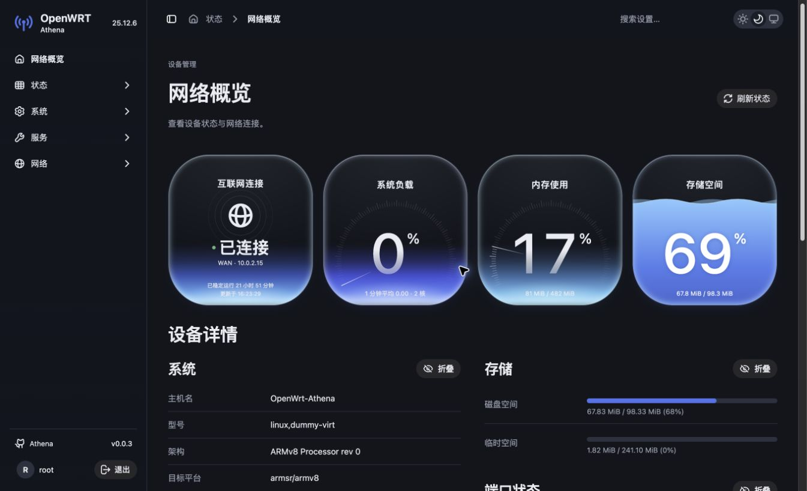
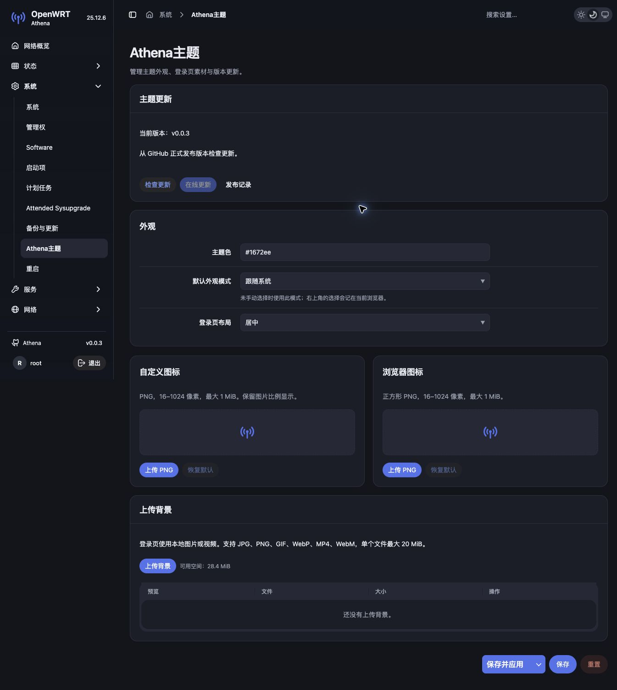
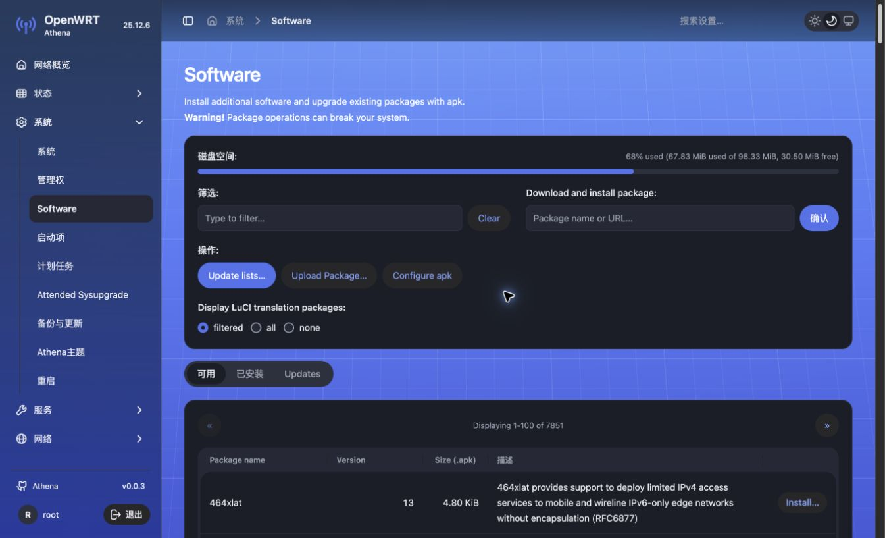

[简体中文](README.md) · [English](README.en.md) · [日本語](README.ja.md) · [한국어](README.ko.md) · [Français](README.fr.md) · [Deutsch](README.de.md) · [العربية](README.ar.md)

# Athena v0.0.6

Athena는 HeroUI를 참고한 OpenWrt LuCI 네이티브 테마입니다. ucode 템플릿, rpcd와 LuCI 기본 JavaScript·폼·UCI 인터페이스를 사용합니다. React 런타임이나 Argon 스타일을 포함하지 않으며 라우터에 Node.js를 설치할 필요가 없습니다.

## 화면 미리보기

로컬 OpenWrt 25.12.6 개발 환경의 다크 모드에서 촬영했습니다. 표시 언어, 버전 및 패키지 목록은 실제 환경에 따라 달라집니다.

### 네트워크 개요

연결 상태, 시스템 부하, 메모리와 물결 애니메이션 저장 공간 카드를 한곳에서 확인하고 장치 세부 정보를 접을 수 있습니다.



### Athena 테마 설정

기본 화면 모드, 로그인 레이아웃, 아이콘 및 배경을 관리하고 정식 Release에서 업데이트를 확인합니다.



### 소프트웨어 관리

LuCI 기본 패키지 관리 흐름을 유지하면서 필터, 설치 작업, 탭과 패키지 표에 일관된 레이아웃을 제공합니다.



## 주요 기능

- 반응형 사이드바, 공통 테이블과 입력 요소, 스크롤 그림자와 대화상자.
- 라이트·다크·시스템 설정 따르기 모드. 초기값은 시스템 설정입니다.
- 중앙 또는 분할 로그인 화면, 경량 SVG 배경, 반투명 유리 패널과 비밀번호 표시 전환.
- PNG 로고·파비콘 및 이미지·동영상 배경 업로드.
- 안정 버전 확인, 파일 검증과 롤백 백업.

## 설치

[Releases](https://github.com/NXN-MAX/OpenWRT-Athena/releases)에서 환경에 맞는 파일을 다운로드하고 `SHA256SUMS`로 확인하세요. `/tmp`에 복사한 후 다음 명령을 실행합니다.

| 환경 | 형식 | 명령 |
| --- | --- | --- |
| OpenWrt 24.10 / opkg | `.ipk` | `opkg install /tmp/luci-theme-athena_*.ipk` |
| OpenWrt 25.12 / apk | `.apk` | `apk add --allow-untrusted /tmp/luci-theme-athena-*.apk` |

독립 SDK 빌드로 OpenWrt 공식 저장소의 서명을 사용하지 않습니다. 두 형식을 혼용하지 마세요. IPK는 `all`, APK는 `noarch` 아키텍처입니다. `luci-base`, `rpcd-mod-ucode`, `ucode-mod-fs`, `ucode-mod-uci`, `curl`, `ca-bundle` 의존성은 해당 펌웨어의 피드에서 설치합니다.

기존 `/etc/config/athena`와 업로드 자료를 보존합니다. 제거 전 다른 설치된 테마로 전환한 후 `opkg remove luci-theme-athena` 또는 `apk del luci-theme-athena`를 실행하세요.

## 설정 및 업데이트

**시스템 → Athena 테마**: `/cgi-bin/luci/admin/system/Athena-config`. 설정 파일은 `/etc/config/athena`입니다. 기본 외관, 로그인 배치와 이미지를 설정할 수 있습니다. 수동으로 고른 외관은 브라우저에 저장됩니다. 호스트 이름은 LuCI의 **시스템 → 시스템 → 일반 설정**에서 관리합니다.

업데이트의 유일한 출처는 정식 Release 첨부 파일 [`athena-release.json`](https://github.com/NXN-MAX/OpenWRT-Athena/releases/latest/download/athena-release.json)입니다. GitHub API, 저장소 브랜치나 미러로 대체하지 않습니다. 매니페스트를 가져올 수 없거나 유효하지 않으면 오류를 표시합니다. 안정 버전, 공식 URL, 파일명, 크기와 SHA256을 확인하고 다운로드 후 다시 검증합니다. 현재보다 새로운 안정 버전만 설치합니다.

내장 업데이트는 `.tar.gz`를 사용하며 설정·자료를 보존하고 `/etc/athena/backups/`에 백업합니다. 패키지 관리자의 설치 버전 기록은 변경하지 않습니다. 패키지 관리자로 업그레이드하려면 해당 IPK/APK를 사용하세요. 압축을 푼 디렉터리에서 `sh scripts/install.sh`로 수동 설치할 수도 있습니다.

## 빌드 및 검사

```sh
npm ci
npm run build
npm test
npm run pack
```

`@heroui/styles`로 정적 CSS와 캐시 해시를 생성하고 `dist/`에 아카이브와 체크섬을 출력합니다. 공식 SDK로 IPK/APK를 빌드합니다. 두 빌드가 모두 성공한 뒤 실제 아카이브에서 매니페스트를 생성해 게시합니다. 새 버전은 `package.json`, 잠금 파일과 `Makefile`의 버전을 일치시켜야 합니다.

장치 검사는 개발자 SSH 래퍼와 격리된 임시 경로를 사용합니다.

```sh
ATHENA_SSH=/path/to/device-ssh scripts/test-device.sh
ATHENA_SSH=/path/to/device-ssh python3 scripts/test-updater-device.py
```

## 구성 및 호환성

`ucode/template/themes/athena/`에는 템플릿, `htdocs/luci-static/resources/`에는 공통 UI·메뉴·설정 화면이 있습니다. RPC는 `root/usr/share/rpcd/ucode/luci.athena`, 업데이트 스크립트는 `root/usr/libexec/athena-update`에 있습니다.

실행 검증 환경은 OpenWrt 25.12.6 / armsr/armv8입니다. IPK는 24.10 SDK로 빌드하지만 모든 장치의 동작을 검증한 것은 아닙니다. 23.05 장치에서는 검증하지 않았습니다. 최신 CSS/JavaScript가 필요합니다. 타사 앱의 Lua 의존성은 테마와 별개입니다. 펌웨어 업그레이드, 장치 기능 및 OpenClash 코어·구독은 테마 검사 범위에 포함되지 않습니다.

## 라이선스 및 참고

Apache-2.0. [LICENSE](LICENSE), [NOTICE](NOTICE), [타사 라이선스](licenses/)를 참고하세요. 참고 자료: [LuCI 테마 구조](https://github.com/openwrt/luci/wiki/HowTo:-Create-Themes), [HeroUI](https://github.com/heroui-inc/heroui), [Gravity UI Icons](https://github.com/gravity-ui/icons), Pin UI Thermal Dial / Theme Switch. React 구현은 라우터에 배포하지 않습니다.
